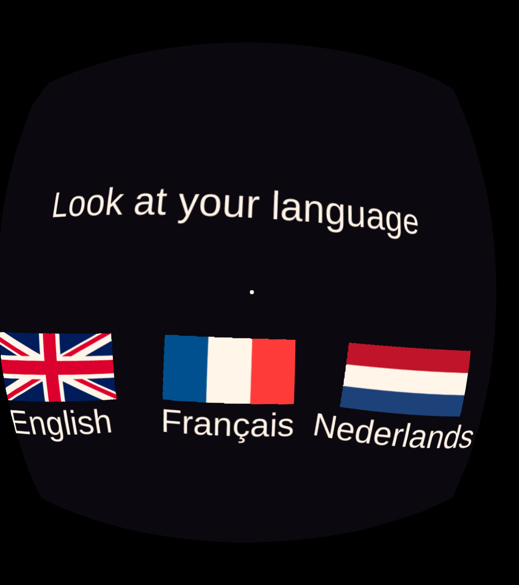

# WeTheFree – Oculus Go 360° video kiosk

An unlocked Oculus Go turned into a self-running 360° video kiosk. It boots into a menu with five flags (🇩🇪 DEU / 🇬🇧 ENG / 🇫🇷 FRA / 🇳🇱 NED / 🇪🇸 SPA). Look at a flag for about 2 seconds to play that language's video. It returns to the menu when the video ends or the headset is taken off.



## Contents
- `GoKiosk/` – Unity 2019.4.40f1 project. The built APK is in `GoKiosk/Build/GoKiosk.apk`.
- `ROADMAP.md` – field-test feedback and open items.
- `headset-setup/SUMMARY.md` – the full log: unlocking the Go, the build settings that work on the Go, alignment, audio levelling, kiosk mode, and maintenance commands.
- `headset-setup/oculus-adb-driver/` – Windows ADB driver for the Go.
- `headset-setup/Oculus-Go-Software-Unlock-Instructions.pdf` – Meta's unlock guide. The unlock zip itself isn't in the repo; get it from Meta's "Unlocking Oculus Go" post.

## Not in the repo
The videos (`*.mp4`) are gitignored. Put them on the headset with:
```
adb push ENG.mp4 /sdcard/Android/data/com.wtf.gokiosk/files/ENG.mp4   # same for DEU, FRA, NED, SPA
```
DEU, FRA, NED and SPA had their audio levelled to match ENG; see `SUMMARY.md` for the settings used.

## Preparing a headset (do this before shipping it)
1. In the Oculus menus, connect Wi-Fi and set the standby timer (we use 4 hours). Once the kiosk runs, these menus are hidden.
2. Connect the headset by USB and run:
   ```
   .\headset-setup\provision.ps1 -VideoDir C:\Users\gmpal\Videos\wtf\go_leveled
   ```
   This installs the APK, copies the videos and launches the kiosk once. Android ignores the boot event for apps that have never been launched, so without that first launch the kiosk wouldn't autostart.
3. Reboot and check that the flag menu comes up on its own.

## Build & install
```
"C:\Program Files\Unity\Hub\Editor\2019.4.40f1\Editor\Unity.exe" -batchmode -nographics -quit -projectPath GoKiosk -executeMethod BuildGo.Build -logFile build.log
adb install -r GoKiosk/Build/GoKiosk.apk
```
`GoKiosk/gokiosk.keystore` (password `gokiosk`) signs the APK. Keep it: updates to the installed app must be signed with the same key.
