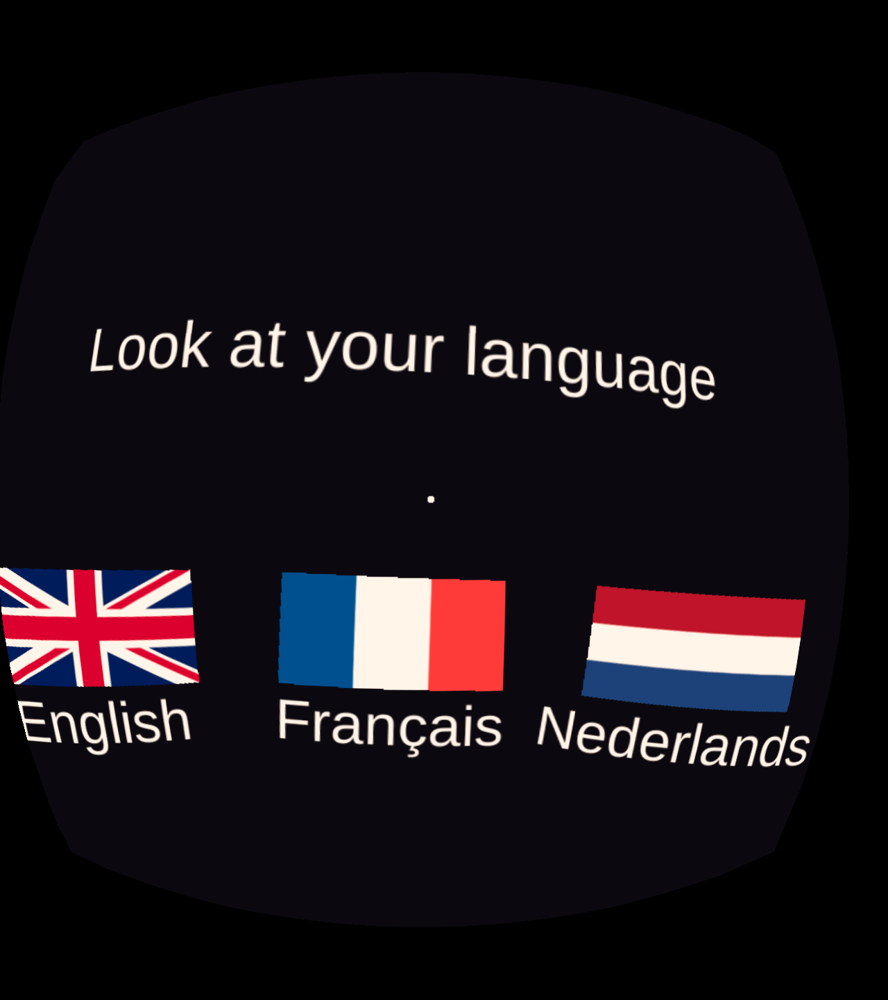

# WeTheFree – Oculus Go 360° video kiosk

An unlocked Oculus Go turned into a self-running 360° video kiosk. It boots into a menu with three flags (🇬🇧 ENG / 🇫🇷 FRA / 🇳🇱 NED). Look at a flag for about 2 seconds to play that language's video. It returns to the menu when the video ends or the headset is taken off.



## Contents
- `GoKiosk/` – Unity 2019.4.40f1 project. The built APK is in `GoKiosk/Build/GoKiosk.apk`.
- `headset-setup/SUMMARY.md` – the full log: unlocking the Go, the build settings that work on the Go, alignment, audio levelling, kiosk mode, and maintenance commands.
- `headset-setup/oculus-adb-driver/` – Windows ADB driver for the Go.
- `headset-setup/Oculus-Go-Software-Unlock-Instructions.pdf` – Meta's unlock guide. The unlock zip itself isn't in the repo; get it from Meta's "Unlocking Oculus Go" post.

## Not in the repo
The videos (`*.mp4`) are gitignored. Put them on the headset with:
```
adb push ENG.mp4 /sdcard/Android/data/com.wtf.gokiosk/files/ENG.mp4   # same for FRA, NED
```
FRA and NED had their audio levelled to match ENG; see `SUMMARY.md` for the settings used.

## Build & install
```
"C:\Program Files\Unity\Hub\Editor\2019.4.40f1\Editor\Unity.exe" -batchmode -nographics -quit -projectPath GoKiosk -executeMethod BuildGo.Build -logFile build.log
adb install -r GoKiosk/Build/GoKiosk.apk
```
`GoKiosk/gokiosk.keystore` (password `gokiosk`) signs the APK. Keep it: updates to the installed app must be signed with the same key.
